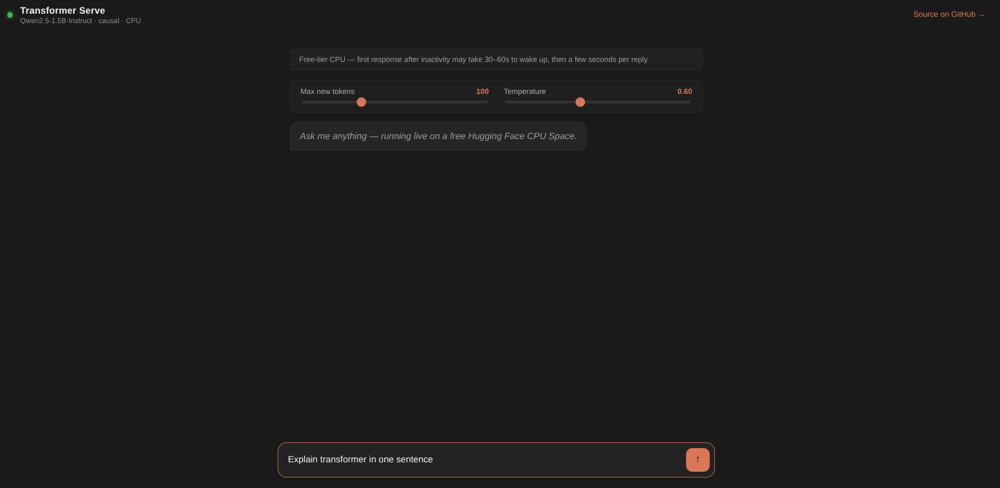

# Transformer Serve

Configurable inference API for Hugging Face text-generation models.  
Swap models via environment variables without changing application code.

<p align="center">
  
</p>

**Live Demo:** [https://ssnym-transformer-serve.hf.space](https://ssnym-transformer-serve.hf.space)  
**Docker Hub:** [https://hub.docker.com/r/ssnym/transformer-serve](https://hub.docker.com/r/ssnym/transformer-serve)

## Try it now — no setup required

The API is live. Run these directly:

```bash
curl https://ssnym-transformer-serve.hf.space/health
```

```bash
curl -X POST "https://ssnym-transformer-serve.hf.space/generate" \
  -H "Content-Type: application/json" \
  -d '{"prompt": "Explain what is AI"}'
```

> Note: runs on free CPU hardware and sleeps after inactivity — first request after idle may take 30-60s to wake up.


## Quick start with Docker

```bash
docker pull ssnym/transformer-serve:latest
docker run -p 8000:8000 ssnym/transformer-serve:latest
```

Open `http://localhost:8000` for the web UI, or call the API:

```bash
curl -X POST "http://localhost:8000/generate" \
  -H "Content-Type: application/json" \
  -d '{"prompt": "What is the capital of France?"}'
```

> The default model is `Qwen/Qwen2.5-0.5B-Instruct`. The image is about 700 MB; the model (about 1 GB) downloads on first start.

### Use a different model

```bash
docker run -p 8000:8000 \
  -e MODEL_NAME="google/flan-t5-small" \
  -e MODEL_TYPE="seq2seq" \
  ssnym/transformer-serve:latest
```


## Run Locally
```bash

git clone https://github.com/ssnym/transformer-serve.git

cd transformer-serve

pip install -r requirements.txt

uvicorn app:app --host 0.0.0.0 --port 8000
```

Test:
```bash
curl -X POST "http://127.0.0.1:8000/generate" \
  -H "Content-Type: application/json" \
  -d '{"prompt": "Explain what is AI"}'
```

### To build the image yourself.

> Built with `Dockerfile.cpu` (CPU-only torch build). Default model is `Qwen/Qwen2.5-0.5B-Instruct` (~1GB) — first run downloads weights from Hugging Face Hub, so expect a few minutes on first start.

Build:

```bash
docker build -f Dockerfile.cpu -t transformer-serve:local .

# Run (default model — Qwen2.5-0.5B-Instruct):
docker run -p 8000:8000 transformer-serve:local
```


## API — `POST /generate`

Request body:
```json
{
"prompt": "Explain what is AI",
"max_new_tokens": 120,
"temperature": 0.7,
"do_sample": true
}
```

Response:
```json
{"output": "Artificial intelligence is the field of building systems that perform tasks requiring human-like reasoning..."}
```

Omitted fields use the defaults in `app.py`. With `do_sample` set to `false`, the model uses greedy decoding and `temperature` has no effect.


## API — `GET /health`

Returns runtime info about the loaded model and device.

```json
{
  "status": "OK",
  "device": "cpu",
  "device_type": "cpu",
  "model_name": "Qwen/Qwen2.5-0.5B-Instruct",
  "model_type": "qwen2",
  "num_parameters": 494032768,
  "configured_model_type": "causal",
  "chat_template": true
}
```

## Features
- Supports Hugging Face seq2seq or causal text-generation models
- Automatic CPU/GPU detection
- Configurable parameters `max_new_tokens`, `temperature`, `do_sample`
- Input validation
- Dockerized for portable deployment
- Deployable to Hugging Face Spaces

## Supported Model Types

- `causal` — decoder-only models (e.g. `Qwen/Qwen2.5-0.5B-Instruct`, `gpt2`, `microsoft/phi-2`)
- `seq2seq` — encoder-decoder models (e.g. `google/flan-t5-small`)

